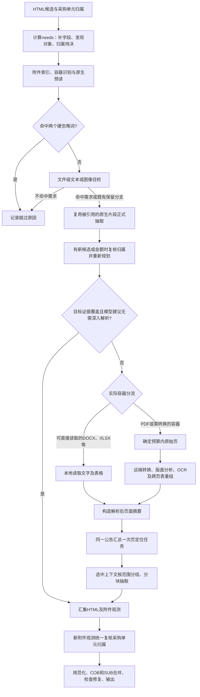

# 附件解析与候选抽取实际流程

核对日期：2026-10-16。本文描述当前工作树的实际实现，用于报告撰写与流程核对，不提出新方案，也不修改规则、提示词或预算。

当前主路线契约为v1.3。案例部分引用2026-10-12保存的过程文件与模型请求，说明当时实际发生的处理；其提示词版本、缺口字段不能当作当前新版流程已重新测试的证据。本文没有重新调用模型或OCR服务。

## 一、可用于报告的流程说明

系统先从公告正文和表格形成标的物、供应商及金额观测，完成采购单元归属复核，再根据已有候选计算附件需要补充的字段、对象发现任务和归属待决任务，形成需求集合`needs`。因此，附件处理既用于补全已知对象，也用于发现公告未列明的标的或供应商。

附件经容器识别和索引后，先进行文件级目检。对于能够读取原生文字的文件，系统将受长度限制的文字、表头及带来源编号的片段连同`needs`交给模型；对于无法有效读取文字且具备预览能力的文件，使用少量页面缩略图或内嵌图片进行图像目检。模型返回发现的字段、文件性质、来源引用及是否还需深入解析的建议，程序依据字段是否命中需求决定文件是否继续处理。除两个已明确约定的文件名忽略词外，文件名本身不直接决定内容价值；无法完成目检的文件沿既有保留分支继续尝试处理。

目检通过后，系统先复用模型已经引用的原生文字片段，调用与正式附件抽取相同的抽取器，形成新的标的物候选、供应商候选、独立包金额及缺口证据关系。有新候选或金额时，复用统一采购单元归属组件复核归属，并更新后续需求上下文。只有对应补字段目标均有有效抽取证据，且目检模型明确建议无需深入解析时，才跳过该文件的后续解析；发现更多对象的任务不会因此被宣告完成。

仍需深入处理的文件按实际容器分流：可以直接读取的DOCX、XLSX等文件由本地读取器转换为文字和表格上下文；PDF以及需转换的复杂容器走远端解析服务。长PDF先依据既有的本地启发式排序，在预算内确定送往解析服务的原始页。解析服务负责文档转换、版面分析、OCR识别及表格重建，并尝试在连续页段内合并跨页表。返回的页面记录仍带原始页号，但某张表的内容可能已包含后续多页的续表。

随后，系统为解析后的页面记录构造精简摘要，将同一公告下各文件的摘要、需求和原生证据复用状态汇总给页定位模型。模型选择的是需要进一步抽取的页面上下文，而不是再次选择OCR页。选中的上下文按采购单元范围分组、按数量分块，连同更完整的文字、表格及来源引用送入附件抽取模型。若跨页表已被合并到起始页记录，选中这个起始页记录即可把续表内容一并送入抽取。

原生证据复用与深入解析两条路径产生的附件观测，最终与HTML候选汇合，再进行统一归属复核、字段规范化、标的合并和供应商合并，之后检查修复并输出结果。字段被看见、形成候选和被最终采用是三个不同状态，均不能相互替代。

## 二、先区分三个“页”和两种模型任务

| 名称 | 实际含义 | 不能据此推出什么 |
|---|---|---|
| 原始PDF页 | PDF文件中从1开始的物理页序号；可能与印刷页脚不同 | 不能把页脚数字直接当程序页号 |
| 解析后页面记录 | 解析服务返回、经客户端转换后的文字与表格容器，带`page_no` | 表格内容不一定只来自这个物理页 |
| 抽取上下文 | 页定位选中后，实际送入附件抽取器的文字、表格和来源片段 | 一个上下文不一定只覆盖一个物理页，也不一定形成一个最终标的 |

**预算选页发生在解析服务之前，页定位发生在解析服务之后。** 前者决定哪些原始页消耗远端解析预算；后者由模型根据解析结果的摘要，决定哪些上下文进入业务候选抽取。

这里的模型任务也要分开：PaddleOCR-VL负责文档识别与结构恢复；业务LLM负责文件目检、页定位、候选抽取、归属和合并。业务LLM的页定位请求不等于逐页OCR请求。



图中的“无需深入解析”仅针对当前文件。缺口状态为证据就绪，也不等于最终字段已经被采用或公告清单已经完整。

## 三、逐步展开当前实现

### 1. 需求规划：不是把所有空格机械列成缺口

入口为`pipeline.py`中的主流程和`s03_plan.py`中的`plan_projects()`。

规划基于公告理解、HTML候选及已复核的采购单元归属，综合已有字段覆盖、附件指针、对象类别等既有条件生成需求，包括：

- 已知COB的字段补全，以及包金额、中标供应商、得分等缺口。
- 已知SUB的最终投标/响应报价、审查状态、未通过原因等缺口。
- 发现更多标的、供应商的任务，而非只补现有对象的空值。
- 尚未确定采购单元归属的观测所需补充的证据。

需求带采购单元引用、字段、原因、`need_id`、任务目的、对象目标和状态。任务目的区分`fill_field`、`discover_objects`、`resolve_binding`；`missing_fields`主要描述已知对象缺失字段，不能代表全部需求。

附件链路使用这些需求说明“我们在找什么”。历史保留的`search_queries`不送入当前附件模型调用，也不拿公告正文生成的检索词去筛附件页。

### 2. 文件预读和目检：每文件独立，不先全量OCR

入口为`s04_attach.py:triage_files()`，原生预读在`parse/peek.py`，目检在`parse/screen.py`。

系统按照嗅探出的实际容器读取，而不是仅按扩展名派发。目检前会尝试原生预读，得到可读性标记、文字视图、表头和带编号片段。PDF预读最多读取前40页的原生文本，但**模型看到的文字视图最多3000字符，带编号片段也另受合计约3000字符的限制**。因此，“本地读到了前40页”不能写成“目检模型看完前40页”。表头另行传入，最多3组。

目检按以下方式输入：

| 分支 | 目检模型实际收到的主要内容 |
|---|---|
| 文本目检 | 文件名、实际格式、页数、需求、有限文字视图、表头、带来源编号的原生片段 |
| 图像目检 | 文件名、需求、少量缩略图或内嵌图片 |
| 无法完成预览、调用失败等 | 按既有保留分支继续处理，原因写入文件决策 |

PDF图像目检默认最多2张，来自首页和靠近中部的一页，并非整份PDF逐页生成缩略图再判断。DOCX的图像分支可取最多2张内嵌图片，它们也不等同于渲染后的文档页。可读PDF通常走文本目检，无需在这一步生成缩略图。

模型输出文件性质、`confidence`、`found_fields`、相关主体与公告性质线索，以及原生证据引用`evidence_refs`和`requires_deep_parse`建议。程序用`found_fields`与需求字段求交，得到`needs_hit`：有命中则保留，无命中则跳过；需求为空时保留。`confidence`保留审计并参与现有文件排序，不作为放行阈值，当前也没有文件数截断。

已明确批准的文件名硬忽略只有“中小企业声明函”和“残疾人福利”。命中后不进入模型目检或深入解析；当前调用顺序仍可能已经做过原生预读，不能写成“完全不读取文件”。其他名称只作输入线索。

目检结果记录在`05_file_decisions.json`。其中`screen.view_chars`当前记录的是预读字符统计，不能用它直接声称模型看到了同样多的字符，应以请求中的实际视图和片段为准。

### 3. 原生证据复用：先把已看见的片段变成正式观测

入口为`extract_screen_evidence()`，后续覆盖核对为`apply_native_resolutions()`。

对于保留的文件，系统只取目检模型确实引用的、已经展示过的原生片段，构造成抽取上下文，再调用与深入解析路径相同的`extract_attachment_candidates()`。这一步没有重新读取整份文件，也没有把未展示的后续页自动加进来。纯图像目检不会凭空产生可复用的原生文字。

抽取输出沿独立通道接收：COB/SUB候选、包金额观测、`need_resolutions`。合法条目保留，非法条目的原值及错误路径审计；它们不是已经合并好的最终业务结果。

如果出现新候选或包金额，主流程先把HTML、原生候选和金额交给统一采购单元归属组件，复核后更新理解、重新规划需求，再检查缺口证据关系。检查关注需求是否存在、字段和目标是否对应、证据是否属于同一采购单元，以及来源是否能唯一支持该字段。SUB还要对应明确来源观测，未知值不能充当已补全。

只有相关非发现类需求的目标覆盖检查均通过，而且目检返回`requires_deep_parse=false`，才将该文件标为`native_evidence_ready`并跳过后续深入解析。否则为`native_evidence_partial`，仍继续处理。`discover_objects`保持待决，不能用“某些字段补到了”证明没有更多对象。

`05c_native_extraction.json`保存抽取结果、金额、缺口关系及接收审计，并区分形成候选、仅金额、尝试为空、失败和未调用。已有片段和未决状态还会传入页定位及合并证据，但不强制将相应原始页并入解析预算。

### 4. 深入处理的分流：可读性不等于是否走OCR

入口为`parse_pages()`，本地读取器为`documents.py`。

| 实际容器与状态 | 当前读取路径 | 形成的上下文 |
|---|---|---|
| 不需格式归一化的DOCX | 本地读取段落及表格 | 整份文档组织成一个逻辑页记录，不是按Word印刷页分页 |
| 不需格式归一化的XLSX/XLSM | 本地读取工作表和单元格 | 每个工作表一个逻辑页记录；文字摘要最多取400行，表格结构保留读取到的行 |
| PDF，包括有原生文字的PDF | 远端解析服务 | 预算内页面的版面识别、文字和表格结构 |
| 需转换的旧Office容器、图片等 | 按既有支持范围进入转换/远端解析 | 成功时形成解析结果，失败则记录原因 |

因此，不能写成“可读文件全部直接全文送LLM，不可读文件全部先OCR”。“可读”首先影响目检采用文字还是图像；深入处理采用本地读取还是远端解析，还取决于容器和转换状态。本地读取得到的内容同样要经过摘要定位及后续上下文限制，不会无条件整份送入一次业务抽取调用。

### 5. 预算选页：40是页数，不是原始页号上限

入口为`_budget_pages()`、`rank_budget()`和`parse/peek.py:page_profiles()`。

PDF超过40页时，系统在本地遍历整份PDF，统计逐页原生表格数以及既有`PRICE_HINT`命中数。排序依次为：有表格的页优先、提示词命中多的页优先、原始页号靠前的优先；取预算内40页后，恢复为原始页序发送。

这里是**已经批准并冻结的确定性启发式排序**，不是LLM逐页内容判断。既有提示词为“单价、数量、总价、中标金额、成交金额、规格型号、品牌、制造商”；它们不是由公告正文生成的检索词。本说明如实记录这部分现状，不将它表述成全链路都由模型选页，也不改动这条规则。

这个扫描不等同于目检预读：目检PDF文字预读止于前40页，而预算画像可以遍历整份长PDF。因此，页号49、88或97进入解析不违反40页预算。短PDF、画像失败或排序结果恰好就是前40页等情形，沿既有前部解析路径处理。

这一排序无法保证召回全部业务相关页。扫描PDF没有可利用的原生表格及提示词时，排序可能退化为页序；预算外页不能假定已经被OCR或已经进入业务抽取。

客户端向解析服务上传原文件，并附所选页号及预算参数；由服务端切出连续页段处理，并非客户端只上传选中页的图片。

### 6. 解析服务：包含OCR，但职责比OCR更宽

调用端为`parse/client.py:ParseClient.parse()`，仓库内服务端实现为`deploy/parse_service.py`。

解析服务负责必要的Office转PDF、选定页段切片、版面分析、PaddleOCR-VL文字及表格识别、跨页表重组，以及结果序列化。当前部署实现支持PaddleOCR-VL v1.6管线，并可连接独立的vLLM识别后端。因此，运行记录里的“解析服务处理页数”指送入这条文档解析管线的页数，不是业务LLM调用次数，也不是OCR内部识别区域数。

选定的PDF页按连续页段处理。在同一段有多页且开启`merge_tables`时，服务调用：

```python
pipeline.restructure_pages(
    results,
    merge_tables=True,
    relevel_titles=True,
    concatenate_pages=False,
)
```

`concatenate_pages=False`不表示禁止跨页表合并。它保留页面记录组织，但`merge_tables=True`仍可以把续表内容合并到前面的表中。成功合并后，某个起始页记录可能持有完整长表，后续记录只剩页眉、页脚或表后正文。

这不是“强制把相邻页全部作为业务证据”的规则；是否、如何恢复跨页表由解析管线执行。重组可能失败，警告会留痕；不能保证所有跨页表都正确合并，也不能声称跨越未解析间隔的页一定会合并。

服务返回Markdown、版面块和表格信息，客户端再转换成`page_no / text / tables / chars`结构。`05b_parsed_pages.json`保存文件级解析摘要、表头等信息，并非保存全部解析正文；完整页面上下文在运行中继续向后传递，历史请求录制也可用于核对实际发送内容。

### 7. 页定位：同一公告汇总摘要，通常一次逻辑请求

入口为`locate_pages()`，位置在解析、重组之后。

程序为解析后页面记录生成摘要，主要包含：

- 页号、正文前300字符。
- 各表表头、表格数、全部表格的数据行总数。
- 第一条数据行的前8个单元格示例，以及正文字符数。

文件层同时附带文件类别、采购单元提示、目检发现字段、被引用的原生片段、复用状态及相关需求。页面摘要不是另调用模型逐页生成，而是程序裁取和计数得到的。

当前存在既有摘要前置条件：正文不足20字符且没有表格数据行的记录不加入摘要；每文件最多送80条摘要。因此，“解析服务返回的每一页一定逐页被业务LLM审查”也不是准确表述。

代码在收集同一公告各文件摘要后，调用一次页定位逻辑请求，模型同时接收`files + needs + package_registry`。它不是一页一次，也不是每个文件各调用一次。协议修复或失败重试可能产生额外实际调用，应与正常逻辑粒度区分。

模型返回`file_id`、`page_no`、预期字段、采购单元范围、抽取模式和理由。既有执行上限为每文件30条、每公告100条选中记录。范围用于后续任务切分，不是最终候选的归属裁决；多单元或歧义内容可保持公告范围，后续仍由统一组件复核。

**此时模型看到的是重组后表格的摘要。** 如果第40页记录已有33行长表，而第41—46页记录只剩页脚，那么模型选中第40页而不选这些续页，并不等于遗漏续表内容。

### 8. 附件抽取：按采购单元范围分组，再按上下文数量分块

入口为`extract_attachment_candidates()`，原生复用也调用它。

页定位选中后，程序取对应页面记录的较完整内容，加入来源引用、文件名、目检发现字段、报价主体线索、已知中标人、采购单元目录和`needs`。普通页面上下文正文最多6000字符、最多6张表；表格不是只给摘要里的第一条示例行，选中的表会带其数据行进入抽取上下文。

上下文先按`package_scope`分组，再以每块最多12个上下文调用抽取器。范围可以是已知采购单元，也可以是`announcement`或`unknown`。因此调用单位不是固定一页一次，也不是每个文件全文一次；同一采购单元的多个文件可在一块中，超出12个上下文则分成多块。

抽取器形成COB、SUB及独立包金额观测，并保留它们的文件、页锚点、表行或原生片段来源。输出按独立通道接收与修复；在原生复用路径还收集缺口证据关系。接收通过仅表示结构与引用可用，不表示最终业务字段已经确定。

### 9. 与后续规范化、合并的衔接

深入解析产生新候选或金额后，主流程再次复用同一个采购单元归属组件，处理HTML、原生复用、深入解析候选及金额。不能把文件名提示或分块时的范围直接当最终归属。

`07_attachment_extraction.json`中的候选已经汇集原生复用与深入解析结果；后续将它们与HTML候选一起规范化，再进入包内COB合并和SUB合并。不能将05c和07中的候选数直接相加，否则会重复计算原生复用观测。

COB合并通过现有delta协议表达分组、字段来源、计量采用和否定；SUB另行处理供应商身份、角色及字段来源。招标需求可以补充已知成交对象的名称和描述，但不会仅凭需求清单新增成交对象或提供成交计量值。之后仍有检查修复及受约束的产品供应方判断。

因此必须分开陈述三个结论：某段文字进入过模型、模型从中形成候选、该候选字段最终被采用。前一个结论本身不证明后一个。

## 四、实例：t20260309_26250037

本节来自2026-10-12的历史记录。该次页定位使用`locate-pages-v3`，当前代码为v4；以下是历史事实，不是新版重跑结果。原始页号按PDF物理页序号计，解析记录的`page_no`沿用这个页号作锚点；合并表中的各行不保证都来自锚点物理页。

### 1. 三份PDF的目检与原生证据复用

| 文件ID | 文件 | 原始页数 | 当时的目检方式 | 被引用的原生片段 |
|---|---|---:|---|---|
| a001 | 中标结果公告.pdf | 2 | 文本目检 | 第1、2页片段 |
| a002 | 分项报价表.pdf | 6 | 文本目检 | 第1—5页片段 |
| a003 | 安定镇外围防线105国道市界至检查站区段视频监控建设招标文件.pdf | 98 | 文本目检 | 第3页片段 |

三份文件都能读取原生文字，**当次均未走图像目检，不需要在目检时生成缩略图**。表中引用的“页片段”仍受目检总长度限制，不代表整页全文。

8个引用片段进入原生复用，产生33条候选，即31条COB和2条SUB，另有4条包金额观测。三份文件随后都为`native_evidence_partial`，继续深入解析。其中分项报价表虽然得到`requires_deep_parse=false`的模型建议，但未满足全部覆盖条件，仍未跳过解析。

### 2. 实际送入解析服务的页

中标结果公告解析2页，分项报价表解析6页；98页招标文件选取40页，总计48页。招标文件的40页是：

```text
3、8、9、10、24、25、26、27、28、29、30、35、36、37、38、39、
40、41、42、43、44、45、46、47、49、50、51、52、53、57、58、
69、75、86、87、88、89、90、95、97
```

这解释了40页预算下为什么模型后续能看到49、50、88等页内容：预算限制的是选取数量，原始页号并不限于1—40。

### 3. 页定位只请求一次，汇总44条摘要

当次页定位请求同时包含三份文件：a001为2条、a002为3条、a003为39条，共44条摘要。解析48页与输入44条摘要并不矛盾，部分记录未进入摘要。

模型返回11条选中记录：

| 文件ID | 选中记录的页号 |
|---|---|
| a001 | 1 |
| a002 | 1、2、6 |
| a003 | 3、39、40、49、50、57、88 |

该记录说明的是模型当时选了什么，不表示每一条选择都被另行判定为最优。

### 4. 已解析第40—47页，为何业务抽取只选第40页记录即可包含续表

原始PDF中，第一包设备表跨第40—47页分布，包含编号1—27的设备项及规格续行。第40—47页都已在上述40页预算内完成解析，并不是跳过续页OCR后仍能自动获得其内容。进入页定位之前，解析服务已经将它们重组为第40页记录中的一张长表：

| 阶段 | 第40页记录 | 第41—46页记录 | 第47页记录 |
|---|---|---|---|
| 原始PDF | 起始设备项 | 多页续表 | 最后设备项及表后内容 |
| 解析重组后 | 一张33行表：27条编号设备项加6条无编号规格续行 | 无表格，主要剩页眉页脚 | 无表格，保留部分表后正文 |
| 附件抽取请求 | 携带上述33行表，并带来源片段编号 | 未作为独立上下文选中 | 未作为独立上下文选中 |

核对实际抽取请求，第40页上下文中可以找到：

| 设备项 | 原始物理页 | 抽取请求中的位置 |
|---|---:|---|
| 周界光端机（序号3） | 41 | a003第40页记录的合并表 |
| ★400万智能双光警戒枪机（序号9） | 42 | 同上 |
| 周界雷达（序号19） | 44 | 同上 |
| 智能分析板卡（序号26） | 46 | 同上 |
| 全结构化分析授权（序号27） | 47 | 同上 |

因此，**“未单独选中41—47页”没有造成这张设备续表在该次抽取输入中缺失**。第二包第50页记录也持有重组后的22行工程表，包含19个编号工程项、一个表头内容行及两条续行。

但来源编号有一个必须保留的边界：例如`file:a003:p40:t0:rN`指向解析后第40页记录中合并表的第N行。它不能单独证明该行原本印在物理第40页。当前结构没有为所有合并行保存完整的原始物理页映射，报告不能宣称已经具备逐行跨页坐标还原能力。

同样，这个案例证明的是续表内容进入了抽取输入。对应抽取块同时包含分项报价表，模型回答的27条设备候选引用了分项报价表来源；不能据“输入含招标文件续表”直接推断续表规格全部被提取或最终采用。最终取值要继续查看候选、归属和合并审计。

### 5. 可复核的历史证据

本机历史运行目录：

```text
work/e2e-20261012/runtime/tenants/default/runs/t20260309_26250037/
```

重点文件为`05_file_decisions.json`、`05c_native_extraction.json`、`05b_parsed_pages.json`、`06_page_decisions.json`、`07_attachment_extraction.json`及`08b_merge_evidence.json`。

请求录制位于`work/e2e-20261012/model_trace.jsonl`。当前本地文件第623/624行为该次页定位请求/回答，第626行为含a003第40页完整33行表的抽取请求，第628行为含第50页工程表的抽取请求，第633行为第626行请求对应的回答。更可靠的配对方式是使用`call_id`，因为文件重新整理后行号可能变化：

- 页定位：`b8c240a22bea4e2bb86caa31685dc347`。
- 含第40页合并表的抽取：`d028c0c2d0e74516bd33f79b3d7c669f`。

这些属于本机历史证据，不保证随代码仓库分发；仅有05b摘要不足以复原抽取输入的全部行。

## 五、调用粒度与限制速查

以下为当前代码值，不是建议调整值。

| 环节 | 正常逻辑粒度 | 当前限制或边界 |
|---|---|---|
| 文件目检 | 每文件独立文本或图像目检 | 文字视图最多3000字符；编号片段另受合计约3000字符限制；缩略图默认最多2张；无文件数截断 |
| 原生证据复用 | 被引用片段组织成上下文，调用正式抽取器 | 只复用已展示且被引用的片段，不扩大到全文 |
| 远端解析 | 每保留文件提交解析请求，服务端再分连续页段 | 每文件既有解析预算40页；本地原生读取不走这项远端页预算 |
| 页定位 | 同一公告各文件摘要汇总为一次逻辑请求 | 每文件输入最多80条摘要；选择上限每文件30条、每公告100条 |
| 候选抽取 | 按采购单元范围分组，每块一次 | 每块最多12个上下文；普通上下文正文最多6000字符、最多6张表 |
| 归属及合并 | 按既有统一归属、包内COB/SUB协议处理 | 不是抽取完立即把所有非空字段写入成品 |

失败修复、重试、回退会影响实际调用次数；DOCX逻辑页、工作表、跨页合并表也会使上下文数量不同于物理页数量。不要用一个阶段的“页数”替代另一个阶段的调用量或证据覆盖量。

## 六、实现与文档入口

| 文件 | 核对点 |
|---|---|
| [pipeline.py](../src/ict/pipeline.py) | 原生复用、重新归属与规划、深入解析、候选汇集、规范化及合并的真实顺序 |
| [s03_plan.py](../src/ict/steps/s03_plan.py) | needs生成及目的、目标和状态 |
| [peek.py](../src/ict/parse/peek.py) | 有限原生视图、编号片段、PDF逐页画像 |
| [screen.py](../src/ict/parse/screen.py) | 文本/图像目检、两个硬忽略词、needs_hit门及保留分支 |
| [s04_attach.py](../src/ict/steps/s04_attach.py) | 文件决策、原生复用、预算、解析分流、摘要定位、分块抽取 |
| [documents.py](../src/ict/documents.py) | DOCX与工作表的本地逻辑页组织 |
| [client.py](../src/ict/parse/client.py) | 上传原文件与页号、解析返回值转换 |
| [parse_service.py](../deploy/parse_service.py) | 连续页段、PaddleOCR-VL、跨页表重组 |
| [evidence.py](../src/ict/evidence.py) | 页面和表行证据编号 |
| [fields.py](../src/ict/fields.py) | 唯一字段语义定义 |

总体协议仍以[主路线契约](主路线多步Agent设计契约.md)、[第8步规范](第8步标的合并规范.md)为准，完整执行说明见[主路线实现细则](../eval/主路线实现细则.md)。待完成验收继续只登记在[待优化清单](../eval/待优化清单.md)。本文补充流程表述，不改变这些协议及冻结规则。
