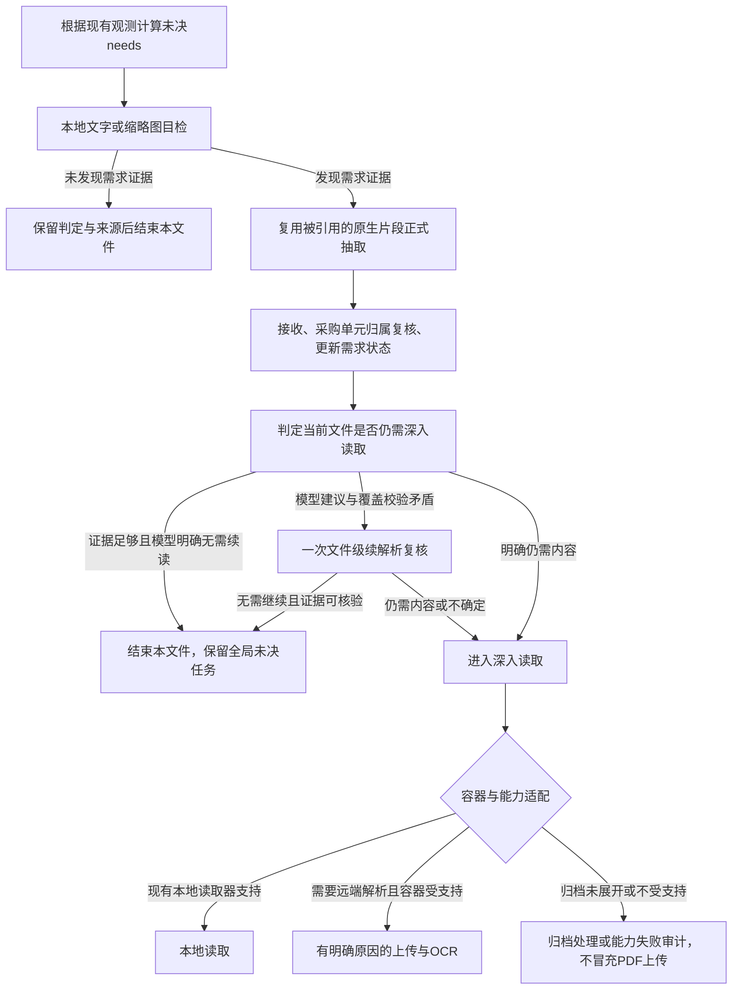

# 附件链路故障分析与修复方案

日期：2026-10-16。依据暂停的真实测试、现有代码、Git记录和离线内存回放编写。本文是拟实施方案，不代表修复已完成；本轮不恢复worker、不调用模型或OCR、不更改提取判定。

## 1. 先明确用户指出的边界

用户的理解正确：目检是应用端读取有限原生内容或生成少量缩略图，调用业务LLM判断；它不应先向远端OCR服务上传完整附件。目检后还有原生证据复用。只有文件仍确有深入读取或版面识别需求，才进入后续读取/解析；需要远端解析的文件才上传。

目前“有附件就进入目检”与“有附件就进入OCR”并非同一条代码规则。问题在于几个环节衔接失败，使进入目检的文件过度保留到了远端上传。上一条诊断将入口扩大与OCR增加联系得过于直接，本文补充它们之间的实际断点。

## 2. 为什么改成有附件就目检

该改动随10月13日官方三表兼容实施，已包含于10月14日提交`842d6a0`。代码在`s03_plan.py`的供应商缺口规划之后：

```python
targets.append({"field": "supplier_name", "reason": "maybe_more_objects", ...})
if has_attachment:
    needs = True
```

此前附件入口主要由COB字段覆盖触发。官方新增供应商报价、审查结论、未通过原因后，如果仍只检查COB完整度，公告即使已经列齐设备，也可能漏掉只写在附件里的投标人和审查信息。因此当时把附件入口扩大，用于发现遗漏供应商和新字段。原实施说明见[官方三表兼容与流程衔接](官方三表兼容与流程衔接-20261013.md)的缺口规划行。

这是实现时为了补全新需求作出的入口选择，不等于用户要求无条件上传OCR。不能把批准整套字段兼容方案理解成授权绕过文件级深入解析判断。

修复建议是保留“以未决needs驱动目检”，明确该入口服务于发现和补全任务，而不是恢复成只看COB覆盖。当前长期保留的对象/供应商发现任务会使多数有附件的公告仍需目检；仅改写入口表达，不会自动减少这些调用。真正需要修的是后续哪些文件继续深入处理。

## 3. 已确认的故障与放大链

### A. HTML表理解的JSON类型契约不完整

暂停前129份HTML表理解回答包含119份数组形式的`package_scope`，其中含60份协议修复回答。调用当前校验器离线重放，这119份均被拒收。已进入处理的12则公告共69张表，59张最终状态为failed。校验器期待字符串，却先用`str()`转换，再报告取值不在目录中。`["1"]`因此变为`"['1']"`而被拒收，错误反馈没有明确说明期待字符串、实际是数组。该问题不只影响速度，也会丢失后续HTML抽取入口；失败的表被标成other/failed，第2B步不再抽它。

两则直接涉及大文件的案例：

| 公告 | 上轮HTML候选 | 本轮HTML候选 |
|---|---:|---:|
| t20260409_26380023 | 13 | 0 |
| t20260509_26533549 | 12 | 0 |

这会把“上游抽取失败”放大成大量待补字段，再向附件传递。固定回答测试使用了预先正确的字符串结构，未覆盖本次真实回答的类型偏移。

同时需要核对字段定义与JSON嵌套位置：表理解应输出角色、范围和列映射；报价和审查业务字段应作为列映射键被说明，不能因字段释义追加而诱导模型在表理解顶层直接抽业务值。当前fields.py的统一v4注册循环确实把这三个业务字段加入了表理解和页定位的“输出字段”列表。它们本应是列映射键或expected_fields里的字段名，不是这两步顶层的业务值。这个契约缺陷可由代码确认，但不能单凭静态检查断言它就是模型返回数组的唯一原因。

### B. “目检命中”被默认当作“待远端解析”

`triage_files()`只要目检放行，就把`read_strategy`设成`target_pages`。它既被原生抽取用来筛文件，又被`parse_pages()`用来提交远端请求。

这使“文件值得复用证据”和“文件已经确定需要深入解析”共用一个状态。后续只有成功把它改成skip才会免去解析；其他情况均继续上传。`requires_deep_parse=false`仅为建议，这本身可以保留审慎校验，但校验失败后缺少一条针对具体矛盾作判断的路径。

### C. 原生抽取、需求重算与免解析条件存在断点

当前先原生抽取，再统一归属、重新规划needs，之后才调用`apply_native_resolutions()`核对覆盖。已被原生候选补到的旧缺口可能在重新规划后消失；程序却只对照新列表，不保留旧任务到已接收证据的完整状态转换。

另外，HTML没有COB时，现有覆盖计算会产生带空`target_candidate_ids`的`fill_field`任务。模型无法引用不存在的旧对象，返回`target_candidate_id=null`的解决记录；接收器正确拒绝无效引用，但上游任务划分和提示词没有把“发现新对象”与“补已有对象字段”划清，最终只保留新候选、没有有效解决记录。

真实例`t20260409_26380023`：

- 目检两个文件均明确返回`requires_deep_parse=false`。
- 原生抽取保留7条候选；相关原生字段已进入新候选。
- 重新规划后，这两个文件的`expected_fields`对应的非发现类需求均为空。
- 当前条件为`complete = bool(relevant) and all(...)`，空列表直接得到false。
- 文件仍为`native_evidence_partial / target_pages`，约158MB的PDF继续上传。

以上已用保存的数据在内存中回放现有函数，结果见本机`work/e2e-20261016/diagnostics/native_skip_replay.json`，没有调用模型或解析服务。

不能只把`bool(relevant)`删除，或者把所有空列表都改成完成。发现任务仍可能需要未展示的后文，尤其不能误关全局供应商名单。正确做法是单独判断当前文件是否还有需取得的内容，并保留全局未决状态。

补充确认：`relevant`当前只按字段名匹配，没有按采购单元、具体任务目标或文件证据范围限定。在内存中调用原函数：只放本包brand需求并给出合法解决记录时，本文件会skip；再加入另一个包尚未解决的brand需求，本文件立即变成target_pages。该反例证明跨包缺口能够阻止免解析，尚未证明它在本轮额外产生了多少上传。修复时不能仅按文件名猜归属，也不能把possible_packages当成最终归属，应使用已有归属组件确认的内部引用、模型引用的任务及接收证据。

此外，`is_winner`和`score`原有任务没有标注SUB目标类型，目标列表默认从COB中查找，可能成为空数组。本轮两则大文件案例的重算结果均出现该状态。这属于“任务发出者与解决记录接收者不一致”的同一问题；修复范围是任务对象和引用传递，不能顺带放宽此前暂缓的供应商缺口关闭条件。

### D. 归档解压失败未与文件索引、解析能力衔接

此前诊断对RAR的表述需要修正：不是“成功解压的RAR没有删除”。`prep/extract_attachments.py`在嵌套归档成功解压后本来就会删除该临时归档。

本轮`.extract_complete`明确记录了`7z_exit_2: Data Error`。解压只产生部分文件，RAR仍被保留。worker忽略了`extract_announcement()`返回的partial及失败明细；索引把遗留RAR列为unknown，目检无法预读后走保留分支，最终把约168MB的RAR提交到不支持RAR的解析接口。

如果只把RAR丢掉并宣布处理完成，会掩盖没有成功展开的内容；如果照旧上传，也不会产生OCR结果。这必须作为“归档未完整展开”处理，保留来源和失败审计。

同一能力衔接问题也出现在真实容器为text的伪装文件：`census`已识别为text，`peek_entry`却没有text读取器，`parse_pages`也没有本地text分支，最终仍按原后缀上传。`t20260210_26166379`的05产物明确记录`no_text_reader:text`，随后PDFium报格式错误；另一则伪装ZIP返回415。这两份小文件不是本轮主要耗时，但证明应修复容器与读取器的统一分派，而不是只增加一个RAR后缀黑名单。文本是否有采购信息仍交模型判断，不能新增“拦截页/声明函无用”等内容规则。

### E. 远端请求目前上传原文件，缺少上传阶段的可见性

`ParseClient.parse()`上传完整文件，页号和预算作为表单参数交给服务端。三个暂停在途文件分别约158MB、115MB、168MB。只读线程栈均停在HTTP请求体发送；服务端仍在接收multipart，尚未进入解析管线。

诊断HTTP上传4MiB约10.43秒，不执行OCR；直接SSH写入`/dev/null`4MiB约4.38秒。这证明传输成本显著，但尚不能据此将所有差额归为转发实现缺陷。

600秒参数是单次网络读写操作超时，不是整个文档调用的总截止时间。当前缺少上传字节、上传完成与服务端实际开始的分段记录，把整段等待显示为“解析”容易误判。

## 4. 拟恢复的流程衔接



文件结束、字段证据就绪、全局标的/供应商清单完整，仍是三个不同判断。目检阶段的`needs_hit`门、两个硬忽略词、页预算和既有低置信处理不因本方案自动变化。

## 5. 拟修改范围与验收

| 顺序 | 拟修改文件 | 改法 | 离线验收重点 |
|---|---|---|---|
| 1 | `fields.py`、`s02_html.py`、HTML表理解提示词 | 明确JSON骨架、字符串类型与合法引用；错误反馈给实际类型、期望类型及路径；业务字段的列映射与顶层位置分开 | 数组、未知引用、同号标段/包、多单元表、列映射的新字段；不得取数组第一项猜归属 |
| 2 | `s03_plan.py`、`pipeline.py`、`receiving.py`、`s04_attach.py`及相关字段/提示词 | 保留目检时需求快照及重新规划后的对应关系；没有旧对象时不要求模型为虚构目标输出解决记录；修正任务实体引用，按文件与已确认采购单元关联任务；把文件续读决定从全局需求关闭中拆开 | 无HTML候选后发现对象、旧need消失、空相关需求、多个单元同字段、明确无需深入但不能证明全局完整、原生尝试为空 |
| 3 | `prep/extract_attachments.py`、`worker.py`、`parse/census.py`、`parse/peek.py`、`documents.py`、`index/build.py`、`s04_attach.py` | 解压partial和具体失败向后传递；统一嗅探容器与读取器能力；归档本体与可解析成员分开；已展开、部分展开和未展开均有状态，保留有效成员；不把不支持的归档或伪装文本上传PDF接口 | 正常嵌套归档、部分损坏、解压失败残留、有效成员继续、伪装PDF/ZIP文本进入本地读取与模型目检、失败证据不丢失或假装完整 |
| 4 | `parse/client.py`、必要的解析响应元数据、worker进度和运行审计 | 分开记录排队、上传、服务端解析、下载；显示字节与文件名；取消能落到对应在途请求 | 慢上传与慢OCR可区分；超时含义准确；取消后不继续新增请求 |

第2项是衔接修复，不借机放宽供应商缺口关闭条件；用户此前暂缓的“供应商缺口错误关闭”风险继续保留边界。新增文件级复核只处理状态矛盾，模型看到已展示片段、实际接收结果和新旧需求，不靠文件名、金额阈值或样本词表替它判断内容。

第4项先解决观察和控制，再据测量选择传输改造。若采用客户端PDF页裁切，须保证原始页号映射与跨页表连续段，且明确它无法缩小“只有3页但全部3页都要”的大PDF。不得为提速直接压低图片质量、截掉表格或恢复COB完整就忽略供应商的旧入口。

### 第2项建议的最小衔接顺序

1. 目检前冻结本次needs快照及采购单元内部引用；目检引用具体need_id、来源片段与是否仍需深入，不能只凭同名字段建立多包关系。
2. 原生抽取继续使用现有抽取器和独立接收通道。已有候选的补字段任务引用真实旧候选；没有旧对象时输出新候选，不伪造补字段目标；包金额使用已有package_amounts通道。
3. 接收合法观测并完成统一包归属后，先将解决记录与它实际收到的旧任务核验，记录旧任务、目标、来源观测及有效采购单元的对应关系。归属发生变化且无法合法对应时明确未决，不能猜映射。
4. 再生成剩余needs，保留已经处理的旧任务到新状态的记录。这样“任务因补到值而消失”不会被误读为“从未解决”，新候选的缺字段也有真实目标。
5. 最后决定本文件是否继续深入：只核对模型引用且归属可验证的本文件任务；跨包未知保持公告范围交模型，不按裸字段名串联。全局发现任务仍可pending，本文件结束不等于名单完整。
6. 目检建议false但抽取/覆盖证据矛盾、或发现任务是否需续读不清楚时，用一次文件级模型复核明确后续需求；不确定继续。不能只删bool(relevant)，也不能直接信任所有false。
7. 只有明确进入深入解析的任务才提交读取器或远端队列。为减少侵入，保留15阶段和原有候选、包归属、合并、数据库业务结构，不引入第二套包编号或全文重抽流程。

上述是待批准的修复设计，不是当前程序已经执行的行为。文件级复核需新增提示词版本及字段契约；不能把旧录制回答当作新协议的实际验收。

## 6. 下一轮测试前的通过条件

1. 用本轮保存的错误回答和合成边界数据做离线回归；不修改打标值，不调内容词表、阈值或正则。
2. HTML结构错误不再因反馈含糊反复重试；多引用不能被擅自归为第一个采购单元。
3. 证明“目检命中但无需深入”的文件不会仅因空相关需求、任务ID漂移或新发现对象没有旧target而默认上传；同样证明证据不足的文件仍会继续处理。
4. 解压损坏可见，RAR本体不会通过保守放行误送PDF接口，成功展开的有效文档仍逐份接受目检。
5. 用本地桩服务验证请求列表、取消与上传分段计时；不需要真实LLM或OCR。
6. 通过后归档故障轮次，用新库、新目录和冻结的同一份50例金标启动下一轮正式测试；不混用本轮8例部分结果作为新成绩。

修改后提示词需新版本，不能用旧回答冒充新模型决策已验收。真实效果只能由下一轮实际抽取评测确认。

## 7. 本次复核的证据与边界

- 复核脚本：本机`work/e2e-20261016/diagnostics/audit_flow_gaps.py`；结果`flow_gap_audit.json`。只读取现有文件并调用当前纯校验/状态函数，未构造API客户端。跨包反例是通用合成数据，不是改业务规则的测试成绩。
- 历史时长对比：本机`work/e2e-20261016/10月12日与本轮耗时对比.md`。相同40页招标PDF服务端由191.873秒变为183.557秒；没有证据支持先调GPU并发来解决当前上传阻塞。历史没有单独上传计时，不能量化新旧带宽差。
- 按Git可确认HTML范围校验器的str转换是早期实现；新目录语义、字段协议和扩大附件入口暴露并放大了它。不能把所有缺陷均说成10月13日新写入，也不能把“有附件可目检”本身等同于无条件OCR。
- 本轮依旧未修改提取代码、提示词、词表、阈值、页预算或并发参数，未恢复暂停worker。归档故障轮次与重跑属于修复通过后的下一阶段，本轮不启动新轮次。

本方案的实施与验收状态统一登记在[待优化清单](../eval/待优化清单.md)；本文解释原因与改法，不作为第二份独立待办。当前真实流程说明见[附件解析与候选抽取实际流程](附件解析与候选抽取实际流程-20261016.md)，故障现场见本机`work/e2e-20261016/`。
