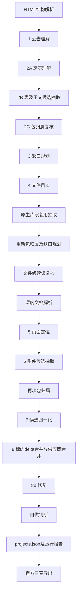

# 当前主流程提示词、Schema与步骤衔接审计

审计日期：2026-11-05。范围为当前磁盘中的生产调用链 `src/ict/pipeline.py`，包含公告、附件、归一化、合并、修复、自供补充和三表导出。不包含 `work/announcement_two_branch*` 的实验逻辑。本次仅静态读取代码及运行字段/Schema导出，不运行模型、OCR、数据库或业务抽取。本文描述代码实际行为，不把提示词意图当成已执行的校验，也不据此推断历史50例各错误的具体成因。

## 一、此前提到的三处到底在哪里

### 1. 投标报价与供应商成交金额分开，导出不自动回填

- `src/ict/fields.py` 的 `bid_amount` 定义为明确披露的最终投标/响应报价；未明确披露为 null。
- `src/ict/prompts/html-candidates-v5.md`、`attachment-extract-v5.md` 要求报价与成交金额分别抄写。
- `src/ict/steps/s07_normalize.py::_normalize_sub` 分别解析 `supplier_award_amount`、`bid_amount`，没有互相回填。
- `src/ict/sub_merge.py::merge_subs` 分别使用 `amount_from`、`bid_amount_from` 指定来源。上下文不是可直接编写的业务数值；模型不能从未抽成候选的原文新增供值。
- `src/ict/official.py::official_rows` 的投标人表报价只读 `money_wan(sub.get("bid_amount"))`。即使供应商成交金额有值，这一格仍可能为空。

这与后来采用的“中标人无单独报价时，以其成交金额作为报价”政策不同。它是已确认的口径差异，不等于每个历史报价空格都由导出这一行造成；若该供应商或成交金额上游就缺失，还存在更早的断点。

### 2. 审查结论只抄明示事实，不根据中标、排名或得分推出通过

- `src/ict/fields.py`：`review_status` 为 passed/failed/unknown，明确禁止根据中标、排名或得分推断通过。
- 当前HTML/附件提示词均保留未通过供应商及其原因；“有得分不代表通过”。
- `s07_normalize.py::_normalize_sub` 只接受三种英文枚举，不把中标身份换算为 passed。
- `sub_merge.py` 从 `review_from` 选择已有结论，未通过原因通过 `review_reason_from` 选择；failed不能同时确认中标。
- `official.py::review_label`：passed导出“通过”，failed导出“未通过，原因”，unknown导出空格。

这与金标的“中标人统一通过；参与人未明示则暂按通过并着色”政策不同。着色是人工标注政策，不是当前模型抽取或导出的默认规则。未通过原因存于 `review_failure_reason`，当前导出拼入“通过审查”列；另一个灰色的“未中标原因”列目前写None，不能混同两个原因。

### 3. 第1步公告理解仍有正文选择和表预览

`src/ict/html_context.py::step1_payload` 当前实际只传：

- 概要中固定六个键：采购项目名称、品目、采购单位、总中标金额、总成交金额、评审专家名单；
- 前40个章节标题；
- 标题匹配 `中标|成交|主要标的|分包` 的正文段落，最多8段；
- 前12张表；普通表每张前8行、键值表前20行；
- 前40项包号线索和正则取得的项目编号提示。

这不是全文理解。更早的 `parse_notice` 也会按HTML节点和编号标题切段：普通片段保留前2000字符、章节正文前4000字符、标题前80字符；没有形成有效章节的内容可能没有进入 `sections`。不能把 `notice.sections` 简称为无损HTML全文。

后续 `s02_html.py` 已将解析出的全部正文段落一次送给供应商候选抽取，但这一路主要接收SUB候选，不负责重新写回第1步的项目名称、项目编号和包目录。后续“整篇正文”并不能保证修复第1步漏掉的项目身份。

## 二、步骤究竟怎样衔接

主链由 `pipeline.run_announcement` 用Python局部变量显式串接；不是模型共享对话，也不是每步自动继承完整state。LLM每次收到当前调用新建的system消息和user payload。上一调用的聊天内容不会自动带入下一调用。

存在15个登记阶段，完整顺序及文件名见附件 `stage_files.json`。登记阶段不等于模型调用数：逐表、逐文件、按包和上下文块可能多次调用；包归属最多在HTML、原生抽取后、深度附件抽取后多次复用；供应商合并和文件续读也有额外模型调用。

内存主载体及其消费者：

|载体|主要内容|下一步怎样使用|
|---|---|---|
|ParsedNotice|标题、概要、章节、表格、包线索、金额锚点|各步显式选择其中的部分组成payload|
|AnnouncementUnderstanding|项目身份、包目录、概要品目及金额|决定后续包集合与project_id，生成计划及最终项目外壳|
|Candidate / FieldObservation|COB或SUB候选，字段原文/规范值/状态，来源及归属|缺口规划、附件补证、归一化和最终合并|
|ProjectPlans / needs|按单元和候选定位的字段任务、发现任务、归属任务|文件目检、原生抽取、续读、页定位和附件抽取|
|FileDecisions / PageDecisions|文件是否深入、发现字段/片段、候选页及范围|确定后续实际读取与分片内容|
|MergeEvidence|文件角色、原文引用上下文、金额观测、原生接收状态|只读补证通道；原文并不自动成为可供值候选|
|MergedProjects|最终Project/Cob/Sub以及采用、拒绝、未决、冲突审计|修复、自供及最终输出|

### 标识符如何保持一致

- `package_no` 在进入后续阶段后代表公告内的内部引用；`source_package_no`保存原编号；`package_kind`区分标段/合同包/未分包；`package_name`为展示名称。不能把这四项视为同一个字段。
- `packages.registry_references` 一次分配目录引用，处理缺号、同号不同类型等情况；包归属输出须引用已有目录，不能新建目录外采购单元。
- `project_id` 由项目名和单元引用生成，成为计划与候选分包键；不是官方公告UUID。
- `candidate_id` 由流水线序号生成，HTML与附件共用递增序列；供应商来源选择及delta引用它。
- `source_ref` 指向实际原文：HTML表行为 `html:t{表序号}:r{行序号}`，正文为 `html:body:{段序号}`；附件为文件/页/表/行片段。引用合法只说明地址存在，不自动证明语义正确。

## 三、提示词、Schema和代码校验的四层区别

1. **有效提示词**：`llm.load_prompt(version)`读取提示词.md，再调用 `fields.field_block(version)` 追加字段语义。只看.md不完整；`STEP_FIELDS`只是声明哪些字段需要向模型解释，不能当作实际payload白名单或JSON Schema。
2. **HTTP输出模式**：普通文本调用发 `response_format=json_object`；没有将Pydantic JSON Schema作为严格结构化输出协议提交。标的合并通常开思考，开思考时不带json_object；图像目检同样没有发送Pydantic Schema，且max_tokens=300。默认合并思考可由环境变量关闭，静态审计无法证明运行中worker实际加载值。
3. **原始答复接收**：`complete_json`解析JSON后调用每步自己的validate，附件还使用ExtractionReceiver逐条接收。检查覆盖面由各校验函数决定，不是所有字段都一律严格检查。
4. **程序封装与变换**：通过上一步后才生成Pydantic对象并补默认值、分配ID、截取来源、归一化等。`schemas.Model`设置extra=allow，`fields`、`needs`、列映射等有自由字典部分；成功构造对象不等于业务含义已对齐。错误若在complete_json返回之后才触发Pydantic校验，通常只被该步捕获为失败，不会自动再问模型。

`complete_json`对JSON/Schema/计划约束最多追加一次修复，携带原答复与错误；business与implementation类别不按同一路径反复问。附件独立合法条目可跨修复保留；delta计划相互依赖，不允许拆接两次回答。HTTP限流/服务错误的传输重试是另一层，次数由并发配置决定，不等于一次业务修复。

## 四、逐步审计

各节中的提示词均指生产实际调用版本。13份完整有效提示词、30个Pydantic模型JSON Schema和15个调用点见附件，以下说明实际输入、控制和变换。

### 0. 原始HTML及附件准备（本地代码，无抽取提示词）

- HTML入口：`html_context.parse_notice`；结构：ParsedNotice/ParsedTable。去除script/style，按选择器定位标题和正文，形成章节与表格，抓原始编号、包提示、金额锚点。
- 关键变换：章节拆分和字符截取发生在模型之前。网页中的任意文本并不保证进入后续sections；表格路径另存，不包含在普通正文文本中。
- 附件入口：index/census/peek，容器嗅探、递归展开、索引和原生节选；并非自动把整个附件全文给LLM。失败与残留归档另审计。
- 下游：ParsedNotice传第1/2步及MergeEvidence；附件索引由第4步读取。

### 1. 公告理解

- 提示词：announcement-v4。输入为step1_payload的筛选概要、标题、预览表和线索。
- 要求：识别全项目名称、采购人、编号、公告类型、采购边界、单元名称与原编号、成交金额及概要品目；不能把多条标的/多家中标直接判成多包，不能拿预算和百分比当成交金额。
- 原始检查：`s01_understand._validate_announcement`检查基本类型、包数组、包类型/名称/编号、金额层级与性质；不证明项目名称是否混入包范围，也不证明名称是逐字原文。
- 程序封装：`checked_categories`要求概要品目去空白后能在概要原文中连续出现；`seal`分配内部引用和project_id、解析金额、处理single/multi/unclear；`fill_package_amounts`按既有金额锚点补传。
- Schema：AnnouncementUnderstanding → PackageUnderstanding/Amount。
- 退出与下游：第1步failed、包结构unclear或项目名缺失时整则提前终止。否则其目录决定后续可引用的采购单元集合，输出01文件。

### 2A. HTML逐表理解

- 提示词：html-tables-v6。每表一次，输入该表表头、前12行、所属章节、前邻文本、其他表的表头/章节摘要，以及第1步包目录；不是完整公告。
- 要求：只判断table_role、row_grain、package_scope、column_mapping；混合报价/审查表为sub_info，未通过名单仍有用。报价/审查是列映射键，不是本步业务值。
- 检查：角色/行粒度枚举、scope必须为目录引用或announcement/unknown字符串；列映射必须是对象且值为字符串。随后将映射值不在真实表头中的项过滤掉。并非对每个映射键做语义正确性证明。
- Schema：HtmlTable/HtmlTables。程序还运行既有promote_object_tables；返回后的表角色可能与原模型回答不同。
- 失败：该表标failed、role=other、scope=unknown；不等于将失败表完整交下一步再抽。
- 下游：2B只对非other、非agency_fee且未失败的表抽取，输出02文件。

### 2B. HTML表与正文候选抽取

- 提示词：html-candidates-v5。表路径逐表调用，传完整表行/source_rows、表头和映射、章节、建议包号及目录。正文路径独立调用一次，传所有已解析sections，payload以SUB抽取为主。
- 要求：原文抄取、同名观测不提前合并、无名但有标的信息的行保留；中标人以实际结果为准；未通过主体与原因保留；品牌/产品供应商/投标供应商分开；报价与供应商成交金额分开。
- 检查：`_validate_source_candidates`检查candidates/fields结构及已有source_ref引用；空引用数组可通过，不进行完整逐字段原文核对。
- 封装：`_append_candidates`分配ID、补唯一包引用、记录source_refs和表头单位；`seal_candidate`通过COB_FIELDS/SUB_FIELDS建立字段壳、映射别名、生成FieldObservation。未知字段保存在unmapped_fields，后续不会自动当作业务字段使用。原文短语“详见附件”等可变成points_to_attachment。
- 额外改写：winner表的供应商单元格与候选名称匹配时会标is_winner；产品供应商误取投标供应商列时可被清空；表内指向附件时加issue。
- Schema：CandidateFile→Candidate→FieldObservation/CandidateEvidence。来源row_text只截前400字符，但source_ref下游可关联另存原文上下文。
- 下游：全部候选进入2C，输出03文件。正文后见信息不会自动重写第1步项目身份和目录。

### 2C. 统一采购单元与金额归属

- 提示词：package-binding-v4。HTML抽取后、原生抽取后、深度附件抽取后可重复调用。单一确定单元且没有独立金额歧义时有本地快捷分支，无模型调用。
- 输入：已知目录、全部已有候选及字段/证据/旧归属，正文、表上下文、附件来源片段、金额observations。
- 要求：逐候选复核而非信任建议号；同家公司可以中多个包；不凭行序或金额排序分包；金额只引用现有amount_ref，已知预算限价不能供成交金额。
- 校验：候选覆盖完整且无重复、目录引用合法、来源存在、每包金额决定覆盖完整、同一金额不能重复供多个包。附件独立金额另有observation_bindings。
- 改写：原Candidate的package_no/project_id/binding及understanding中的包金额；并保留建议、前轮决定和未决。不是按包名称重新创建全部项目或修正全局项目名。
- Schema：输入为现有typed对象；模型答复为字典协议，由bindings内部validate_body等检查，并非独立Pydantic回答类。
- 输出03b含effective_understanding；多轮会覆盖为最新有效目录/金额审计。未归属候选不会因字段有值就被最终输出采用。

### 3. 缺口规划（本地，无LLM提示词）

- 代码：s03_plan.plan_projects。按project_id取COB/SUB；统计字段present/points_to_attachment/missing及覆盖率，保留服务/工程可选字段与既有0.3等阈值。
- 新SUB字段按具体候选创建bid_amount、review_status、必要时review_failure_reason任务；另创建供应商名单发现。COB发现、金额、中标身份/得分及归属缺口也可创建。
- needs携带need_id、field、reason、purpose、state、单元信息、target_entity、目标候选及其供应商名。发现任务不等于给已有候选填字段。
- Schema：ProjectPlans/ProjectPlan/FieldStat，但needs本身仍是list[dict]。
- 下游：目检、原生抽取、续读复核和页定位读取needs。原生观测重新归属后会重算，旧任务状态靠快照及carry函数带回，不是所有局部变量自动同步。
- search_queries仍生成留档，但当前第5步payload不发送它；不能因产物含此字段就认为模型在用公告词筛附件。

### 4. 文件目检与分流

- 提示词：文本screen-file-v4；图像screen-page-v4。每文件按可读性走节选文本或缩略图；不是文件全文判断。图像通常1至2张，PDF可含首页及中部页。
- 输入：文件名/格式/页数、最多3项表头、前SCREEN_TEXT_CHARS=3000字符的content_view、原生source_segments及具体needs；图像路传needs和图像。
- 要求：发现对应字段和need_id、引用原生片段、记录文件类别、报价主体与是否成交材料、是否建议继续深入。无价格审查名单也可有用；confidence只留痕。
- 检查：kind、has_price_table、confidence范围、相关类型；文本evidence_refs须引用给定片段；needs_hit_ids须属于给定任务。
- 实际开关：`_verdict`用found_fields与所需字段的交集needs_hit决定parse/skip；没有needs则保留。needs_hit_ids记录具体目标，不替代字段交集开关。既有两条硬忽略名词仍先跳过，其他名称仅作特征。图像失败/不合法、无模型或不可读等路径保守保留。
- Schema：ScreenDecision转FileDecision/FileDecisions，expected_fields接收目检found_fields，native_segments与evidence_refs继续传递。read_strategy决定是否继续。

### 原生证据复用抽取（登记extract_native_evidence）

- 没有另一套抽取提示词：复用attachment-extract-v5及第6步抽取器，把目检已引用的原生片段组织成contexts；设native_reuse=true，传任务快照、目标和来源。
- 三个独立通道：candidates、package_amounts、need_resolutions；ExtractionReceiver分别检查并保留合法条目。单个错误不要求所有合法结果全部丢弃。
- 原生候选重新进入2C归属，之后才应用解决记录并重算计划。apply_native_resolutions要求同字段、同包、目标有效、引用唯一抽取观测；SUB还须source_candidate_ref指向明确观测，不能只因为同页看见了某家公司就关闭任务。
- 结果状态区分尝试为空、未尝试、只有金额、已抽候选等。发现任务不会因为找到一个对象就自动宣称名单完整。
- 输出05c同时保存候选、接收审计、needs_before/after及旧任务状态。

### 原生抽取后的文件级续读复核

- 提示词：native-continuation-v1。输入本文件目检、任务前后快照、接收观测、相关观测及实际尝试记录。
- 输出finish/deep_parse及证据、理由；它只决定该文件是否深入，不负责宣布全局需求完成。
- 检查：任务ID合法，finish必须引用本文件可用证据；无新增观测情形必须确实已尝试且有特定evidence_basis。失败/不确定不会自动免除解析。
- 本地改写FileDecision.read_strategy/reuse_status及审计，相关新状态写回05。无独立登记文件，因此看15阶段目录本身不足以列出全部模型调用。

### 深度文档解析（登记parse_pages，无业务抽取提示词）

- 本地读取或ParseClient远端版面解析，走相应容器读取器；不是LLM业务候选抽取。
- 只处理仍需深入的文件；残留归档容器不当作普通页上传。保留解压、读取和服务错误。
- 当前每文件深度预算40页；长PDF按既有结构/表格/价格信号排序取页，连续段上传。此处也是确定性选择，不是定位模型已经选出的页。
- 远端可能重组跨页表；返回page_no是上下文锚点，不保证所有重组表行都在该单一物理页。
- 返回parsed内存字典供下一步。05b主要写摘要，不是完整parsed的普遍无损备份；05d另存解析事件。任务owner用于取消本轮本地队列。

### 5. 页定位

- 提示词：locate-pages-v5。对解析后的页面摘要汇总调用：每页text_head前300字符、表头、行数和首行样本，并传known_packages/registry/needs及native_evidence。
- 要求：按可提供缺口的内容选页；页范围可为具体单元、announcement、unknown；不把发现字段等同已采用。
- 检查：_validate_pages主要检查数组及extraction_mode等；随后过滤未知file_id，应用每文件30页、每公告100页预算，coerce_package_scope结合目录/文件提示适配范围；页内检测多包时改announcement。relevance不是按阈值过滤开关。
- Schema：PageDecision/PageDecisions；下游仍须查对应parsed页面，若不存在则留missing_page而非补造上下文。
- 第5步与解析预算作用于不同阶段、不同上下文，40/30/100不能合并解释成一个页数上限。

### 6. 附件抽取

- 提示词：attachment-extract-v5。按采购单元范围分组，每块至多12个上下文，可并行。未知或跨包范围使用相应全公告needs。
- 输入：current_package、known_packages、needs/missing_fields、中标人线索及page_contexts；每页text前6000字符、前6张表，原生source_segments和已有来源片段另传。已有source_segments可包含超过上述text/table预览的内容，不能把6000字符称为整个请求的严格上限。
- 要求：保留观测而不提前合并，引用唯一来源片段；区分需求描述与成交计量，保留未通过主体/原因，供应商最终报价与成交金额分开。
- 原始检查：外层候选数组检查，ExtractionReceiver再逐通道验证实体、fields结构、FieldObservation对象、目录类型、唯一来源页及任务目标。包金额未归属/错误值保留在接收审计，不猜填公告金额。
- 封装：来源定位成功后seal_candidate；可沿用唯一已知中标人/报价主体，按来源类别赋priority；额外字段仍留unmapped_fields。
- 输出CandidateFile，原生与深度结果合并后再归一化。新候选/金额先回到2C，未决归属不能假设下一步会自动补好。

### 7. 归一化（本地，无LLM提示词）

- 输入Candidate列表，深拷贝处理。金额按原值和自己的列单位换算成元，数量数值/单位分离，目录查表规范品目。
- 文本规范化保留原文raw_value，结果写normalized_value；部分COB文本去特定空白/括号，不等于所有主体名统一改写。
- SUB独立处理成交金额和报价；review_status只接受passed/failed/unknown；分数解析失败标unparsable；中标标记按既有枚举解析，缺失默认False并记present。
- Schema仍为CandidateFile。后续_value不是只读raw_value：优先normalized_value，其次只有present才回退原文，unsupported/不可用值不供值。
- 不可把status=present简单理解为人类已验证事实；例如中标缺失被规范成False也是程序默认行为。

### 8. 包内标的合并

- 提示词：merge-objects-v6，执行协议delta-v5。每包给候选观测、基线组、供价资格/可读计量、原文证据、概要品目及金额证据；需要时调用，默认可开思考。
- 九种操作：exclude/split/merge/sum/name_from/price_from/fields_from/fields_reject/category_from_announcement；另输出quantity_accounting，不输出最终业务数值。
- 代码：merge_protocol.compile_plan/materialize检查现存引用、组消耗、重复计量、单位口径、供价资格、字段绑定/否定/依赖、未采用观测说明。模型引用来源，程序执行求和及允许的总价补算。
- 非法依赖计划整包回退；不拆接两次不完整delta。确定性基线及部分旧辅助函数仍在，不能把旧DELTA_ORDER列表或旧_validate_merge当作当前协议唯一校验入口。
- 原来可直接剔除的疑似HTML指针/项目全称行，在有模型路径改为标记；无模型基线仍有旧确定性行为。模型回退的成绩不等同正常delta路径成绩。
- Schema：MergedProjects→Project/Cob；审计含merge_decisions、field_bindings、unresolved、amount_audit、attempts等。

### 8内的供应商合并（不是标的delta的一部分）

- 提示词：merge-subs-v2。在包内SUB候选至少2条且有模型时调用，输入全部SUB字段、证据、未识别字段和引用到的完整source_contexts。
- 输出分组、排除、name/score/amount/bid_amount/review/reason来源以及winner；不允许凭上下文直接写出候选里没有的报价数字。
- validate要求完整无重复覆盖、所有来源在本组、已有新字段必须选择来源或明确unresolved；failed主体不可排除，failed不可同时winner，原因与结论配套。
- 单候选、无模型或回答失败时走_merge_entity确定性路径：按既有名称键和优先级补空；新字段所有同主体观测唯一才采用，冲突未知，failed压制winner。
- 输出Sub包含bid_amount/review_status/review_failure_reason，正常、快捷、失败回退都已找到承载路径。因此静态检查不支持“这三个字段全局未接通”的结论；历史错误仍需逐案看产物。

### 8b. 结果修复

- 提示词：repair-package-v1，只在金额超额且有备选计量读法等条件下调用；输入violations、clusters及已有options。
- 只允许选择已存在cluster/candidate，不能编新金额。代码在trial副本执行，只有检查评分改善才采用；不因模型答了就强制覆盖。
- 缺中标人可从公告赢家线索修补，但已接受供应商合并的包受保护，不重新推翻模型否定身份。
- Schema仍是MergedProjects，输出继续覆盖09_merged_projects.json。

### 自供补充

- 提示词：supplier-completion-v1。仅对最终品牌和产品供应商都空、未被禁止推断的COB，给本包赢家引用及最终标的。
- 输出confirm/reject/uncertain及理由；逐一覆盖待补COB，confirm必须引用有效winner_ref。
- 仅confirm才填product_supplier，单独写inferred_winner_self_supply、supplier_inferences和field_bindings；不填brand，不改SUB报价或审查。
- 同样写09文件；最终候选、合并和自供后的对象不是同一快照。

### 结果、报告与官方三表

- pipeline写公共projects.json：公告外壳加packages；包内Project保留cobs/subs；不是把所有候选原封导出。10_run_report记录耗时、状态和失败，不包含完整原文。
- state的persist_and_report是登记阶段，不代表此函数必然已写真实数据库；账号worker/服务入库是调用方范围。
- official_rows构造三表，money_wan按元转万元两位ROUND_HALF_UP；总表多中标人每人一行，仅一名赢家且供应商成交金额缺失时可回退包金额。投标人报价没有这个回退。
- package_label：确认未分包输出未分包，否则只取package_name，不自动将原编号/title拼回。因此内部含编号不等于最终表一定含完整包标题。
- review_status决定投标人类别：failed→其他，否则winner→中标人，其余参与人。unknown审查导出空；review_failure_reason拼在审查列。标的表类别、投标人未中标原因等灰列存在固定空值。

## 五、专项衔接表

|专项|生产路径|已确认边界|
|---|---|---|
|项目名称/编号|step1_payload→announcement-v4→seal→understanding→各包Project/公共外壳|第2B正文不会自动更正项目身份；错的包目录可能早期终止或限制后续归属|
|包名称|第1步package_name→PackageUnderstanding→package_context/计划→Project→package_label|展示只取名称；title和编号不会自动回拼；与金标完整标题差异不是金额/中标抽取错误|
|投标报价|HTML/附件fields.bid_amount→列单位→normalize_sub→merge_subs来源/回退→Sub.bid_amount→official_rows|无从成交金额回填；原文只在source_contexts出现而未进入候选时，合并模型不能创造供值|
|审查与原因|fields.review_*→规范枚举→merge_subs→Sub→review_label|显式事实口径；unknown不自动通过；失败主体当前已有全链路承载|
|需求关闭|plan.needs→screen→原生接收与2C→apply_native_resolutions→重算/carry→续读复核|看见字段不等于抽取、接收、归属或采用；文件finish不等于全局名单完整|
|金额单位|原文及列标题→CandidateEvidence.column_units→normalize→合并供价/计算→money_wan|跨行、跨包、跨供应商金额不能因数值相同自动通用|
|原文证据|source_ref+CandidateEvidence→MergeEvidence.source_contexts→SUB合并及归属|原文引用存在不证明模型抄写正确；候选row_text截400字时另一路上下文补充很关键|

## 六、代码复核结论与仍待验证事项

### 静态已确认

1. 报价回填政策和审查推定政策与人工金标政策不一致；没有在这次审计中修改。
2. 第1步存在明确章节筛选及表预览；第2B“全部正文”只针对解析后的sections，且不能回写第1步项目身份。
3. 新SUB字段在候选壳、归一化、正常模型合并、确定性回退及最终Sub和导出中均有承载，不是完全遗漏字段。
4. 模型接口没有发严格Pydantic响应Schema。不同步骤有不同强度的局部校验，源码对象extra=allow；实际字段语义不能由schema通过替代。
5. 包归属和缺口规划会被后来的证据重算；其中有原对象原地改写。查看最初01/03/04与最后03b/04时，必须知道它们可能是不同时间的状态。
6. 09文件被合并、8b、自供连续覆盖，05/03b/04也会重写。它们保存最终阶段状态，不是每个历史子步骤均有独立不可变快照。
7. 最新双路实验不在pipeline调用链中；其成绩与协议不能当作当前生产行为。

### 需要逐案/后续实验验证，不能仅凭代码判定

- 某个金标漏值究竟最早在哪一步丢失：解析未纳入、提示输入未传、模型未提取、接收拒收、包归属未决、规范化不可用、合并未采用、导出口径不同，都可能产生同一个最终空格。
- 某包名不匹配究竟是模型取错角色、业务口径不同还是金标不一致。当前没有充分理由新增词表/正则来强行“修正”。
- source_contexts虽有完整引用原文，消费步骤仍不能创造未接收的候选供值。已经看见的内容可能被保留作证据却没有成为可用业务字段。
- 页摘要/预算和原生续读的召回影响，需要真实留出案例验证；本文不把阈值或采样风险写成已证实的效果损失。
- 本文读取的是磁盘源码；正在运行的旧worker是否已重启、是否加载当前版本、是否启用record/replay及具体环境开关，本轮没有验收。

## 七、怎样按一次任务检查实际断点

按下列顺序追一格即可，不需要重跑模型：先确认原文证据；检查01是否建对项目和单元；02表角色/列映射是否保留该表；03是否有对应候选及字段状态；03b是否真实归属；04是否为具体主体建need；05/05c是否看见并尝试接收；06/07是否进入上下文且未被拒收；08规范值和status；09的SUB来源选择或delta采用/未决；最后projects.json及official_rows显示。

回溯时优先记录candidate_id、need_id、source_ref、内部包引用以及当前字段status，不只靠供应商名或最终空格猜断点。原始回答/接收审计、候选观测、最终采用值是三个不同层次。

## 八、审计附件

- [模型实际调用点、有效提示词索引](步骤衔接审计附件-20261105/README.md)：13个提示词版本、14个静态模型调用点。
- [逐提示词输入/输出字段声明](步骤衔接审计附件-20261105/prompt_fields.json)。这是字段解释声明，不是实际传参的完整白名单。
- [30个数据模型JSON Schema快照](步骤衔接审计附件-20261105/schemas_snapshot.json)。用于读结构，未作为HTTP严格输出Schema发送。
- [实际payload构造与模型调用函数快照](步骤衔接审计附件-20261105/payload与调用快照.md)。
- [接收、校验及变换函数源码快照](步骤衔接审计附件-20261105/接收与变换函数快照.md)。
- [登记阶段和文件名](步骤衔接审计附件-20261105/stage_files.json)。
- [本次源码SHA256](步骤衔接审计附件-20261105/source_sha256.json)。

本次只增加审计文档及采集脚本，未改生产流程、提示词、Schema、规则或阈值。

## 九、源码入口速查

|职责|源码位置|
|---|---|
|入口与步骤串接|[src/ict/pipeline.py:52](D:/all_contest/2026_9_23_ICT/src/ict/pipeline.py:52)|
|提示词拼接|[src/ict/llm.py:43](D:/all_contest/2026_9_23_ICT/src/ict/llm.py:43)|
|通用接收与一次修复|[src/ict/llm.py:232](D:/all_contest/2026_9_23_ICT/src/ict/llm.py:232)|
|HTML结构解析|[src/ict/html_context.py:158](D:/all_contest/2026_9_23_ICT/src/ict/html_context.py:158)|
|公告输入筛选|[src/ict/html_context.py:272](D:/all_contest/2026_9_23_ICT/src/ict/html_context.py:272)|
|公告接收与封装|[src/ict/steps/s01_understand.py:183](D:/all_contest/2026_9_23_ICT/src/ict/steps/s01_understand.py:183)|
|逐表理解|[src/ict/steps/s02_html.py:57](D:/all_contest/2026_9_23_ICT/src/ict/steps/s02_html.py:57)|
|HTML候选抽取|[src/ict/steps/s02_html.py:153](D:/all_contest/2026_9_23_ICT/src/ict/steps/s02_html.py:153)|
|包归属|[src/ict/bindings.py:29](D:/all_contest/2026_9_23_ICT/src/ict/bindings.py:29)|
|缺口规划|[src/ict/steps/s03_plan.py:33](D:/all_contest/2026_9_23_ICT/src/ict/steps/s03_plan.py:33)|
|文件分流|[src/ict/steps/s04_attach.py:142](D:/all_contest/2026_9_23_ICT/src/ict/steps/s04_attach.py:142)|
|文件判定|[src/ict/parse/screen.py:263](D:/all_contest/2026_9_23_ICT/src/ict/parse/screen.py:263)|
|原生复用|[src/ict/steps/s04_attach.py:610](D:/all_contest/2026_9_23_ICT/src/ict/steps/s04_attach.py:610)|
|原生证据任务状态|[src/ict/steps/s04_attach.py:640](D:/all_contest/2026_9_23_ICT/src/ict/steps/s04_attach.py:640)|
|续读复核|[src/ict/steps/s04_attach.py:696](D:/all_contest/2026_9_23_ICT/src/ict/steps/s04_attach.py:696)|
|文档解析|[src/ict/steps/s04_attach.py:254](D:/all_contest/2026_9_23_ICT/src/ict/steps/s04_attach.py:254)|
|页定位|[src/ict/steps/s04_attach.py:366](D:/all_contest/2026_9_23_ICT/src/ict/steps/s04_attach.py:366)|
|附件抽取|[src/ict/steps/s04_attach.py:454](D:/all_contest/2026_9_23_ICT/src/ict/steps/s04_attach.py:454)|
|独立通道接收|[src/ict/receiving.py:20](D:/all_contest/2026_9_23_ICT/src/ict/receiving.py:20)|
|候选字段壳|[src/ict/candidates.py:93](D:/all_contest/2026_9_23_ICT/src/ict/candidates.py:93)|
|归一化|[src/ict/steps/s07_normalize.py:42](D:/all_contest/2026_9_23_ICT/src/ict/steps/s07_normalize.py:42)|
|供应商归一化|[src/ict/steps/s07_normalize.py:162](D:/all_contest/2026_9_23_ICT/src/ict/steps/s07_normalize.py:162)|
|标的合并|[src/ict/steps/s08_merge.py:1298](D:/all_contest/2026_9_23_ICT/src/ict/steps/s08_merge.py:1298)|
|delta编译|[src/ict/merge_protocol.py:93](D:/all_contest/2026_9_23_ICT/src/ict/merge_protocol.py:93)|
|delta落地|[src/ict/merge_protocol.py:332](D:/all_contest/2026_9_23_ICT/src/ict/merge_protocol.py:332)|
|供应商合并|[src/ict/sub_merge.py:9](D:/all_contest/2026_9_23_ICT/src/ict/sub_merge.py:9)|
|结果修复|[src/ict/steps/s08b_repair.py:111](D:/all_contest/2026_9_23_ICT/src/ict/steps/s08b_repair.py:111)|
|自供补充|[src/ict/steps/s09_supplier.py:12](D:/all_contest/2026_9_23_ICT/src/ict/steps/s09_supplier.py:12)|
|官方导出|[src/ict/official.py:45](D:/all_contest/2026_9_23_ICT/src/ict/official.py:45)|
|审查显示|[src/ict/official.py:36](D:/all_contest/2026_9_23_ICT/src/ict/official.py:36)|
|包名显示|[src/ict/packages.py:12](D:/all_contest/2026_9_23_ICT/src/ict/packages.py:12)|
