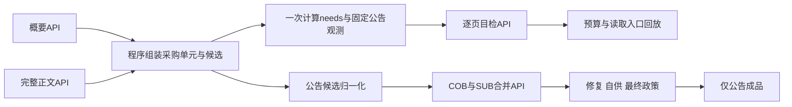

# 三案例逐步决策链与漏判多判原因

> 2026-11-09审计修正：德州将服务范围从spec_model清空符合用户明确口径，不作为字段损失；此前把服务技术要求、交付方案普遍列为应读依据的解释撤回。劳务支付表仅新增预算，本例最终字段已具备成交身份与金额，德州OCR有效数从3改为2、多读从37改为38。下文保留原诊断及API事实，旧价值标签不作当前验收。详见[改动自审](前半程改动自审-20261109.md)。

2026-11-09。选取德州城市生命线二期、北京安定镇视频监控、中卫涉税研判中心三例。只读上一轮真实API记录、提示词快照、阶段产物和既有调度回放；本次新增API/OCR/数据库调用均为0，生产实现保持。

本报告用两类关系组织证据：

- **代码确定链**：已给出的字段进入明确条件，随后执行相应分支，可从代码和阶段产物核对。
- **模型解释链**：实际提示词、实际输入与API公开JSON中的reason相互对应，说明这次调用采用了什么判断。提示词措辞的影响属于有证据的解释，未做替换提示词的反事实实验。

## 1. 这轮记录怎样连接

实际完成了两段实验，连接点是同一份公告候选和needs快照：



概要/正文及后半程真实记录在`work/front-half-repair-20261108/live-capacity`；该轮附件目录显式为空。页目检在`work/attachment-coverage-expanded-20261109`，复用前一目录的固定公告观测，运行至OCR/直抽入口。附件抽取、附件包归属和携带新附件候选的delta合并，留待后续实验。

三例有17次公告及后半程调用、192次已保存图像页调用，涉及41份文件、367个观察单位。已核对每个页请求的needs与对应`04_project_plans.json`逐项一致。完整输入、公开JSON输出、调用元数据和阶段字段已汇总到：

`work/attachment-coverage-expanded-20261109/analysis38/case_traces/`。

当前真实提示词：概要summary-v2，正文body-v4，页目检screen-page-v7，COB合并merge-objects-v6，SUB合并merge-subs-v2，自供supplier-completion-v1。以下只引用公开结构化reason，不使用思考摘录解释程序分流。

## 2. 德州：同一供应商的观测怎样生成重复缺口，并扩展到历史合同

案例：`t20260602_26668587`，德州市城市管理局城市生命线安全监管工程市级平台项目（二期）。

### 2.1 公告与缺口

| 节点 | 实际关键输入/输出 | 下一个节点的直接影响 |
|---|---|---|
| 概要API | 总中标金额`86.300000万元`，性质`award` | 程序保留公告级总额863000元 |
| 正文API | A包828000元、B包35000元；2条COB、10条SUB观测 | 形成2个采购单元、12条候选 |
| 程序组装 | 目录内部引用`1/2`，名称明确包含本案A/B包；两路身份无冲突 | 所有页模型收到这个采购单元目录 |
| A包中标行 | `cand_000002`：中电信数智，`is_winner=true`，`supplier_award_amount=828000元`，`score=87.67` | 单看这条观测，最终政策可给中标人补报价 |
| A包评分行 | `cand_000003`：同一企业，`review_status=passed`，`score=87.67`，单独报价、成交金额及中标标志为空 | 缺口计算逐候选处理，在这一条再次登记`bid_amount`缺口 |
| B包对应两行 | `cand_000009`有35000元中标金额；`cand_000010`是同企业评分/审查行 | 同样生成对`cand_000010`补报价的任务 |

代码顺序为：公告抽取 → 逐候选缺口 → 附件 → 归一化 → 供应商合并。计算缺口时，两条同名企业观测还保持独立。`supplier_defaults()`只查看当前候选，因此第一条通过成交金额得到报价政策，第二条仍以空报价进入needs。

本例needs共18项：

- 每包`category_name/brand/unit_price`各一项，共6项；
- A包5条、B包3条逐供应商`bid_amount`，共8项，包含上述两条中标人评分观测；
- 每包发现更多`object_name/supplier_name`各一项，共4项。

**因果链一（确定）：同一供应商拆成中标行和评分行 → 缺口逐候选计算 → 对中标人的第二条观测再生成补报价任务。**

另有一个确定的任务扩大来源：两条COB均未带`category_type/category_code`。规划器靠这两个字段识别B/C类，再将品牌等设为可选。本例类型集合为空，走通用字段覆盖检查，因此服务标的也收到品牌、单价和品目任务。包名称中“平台”“监理”的文字不参与这段代码。

### 2.2 三个真实页请求

所有请求均含同一份18项needs、完整采购单元名称和固定已知观测。下面三页展示三种判断过程。

| 页 | 当前页与输入上下文 | API公开决定与reason | 判断采用的关系 |
|---|---|---|---|
| `759af93b12202112_0004` | 原生文本0字；图像是庆云县智慧燃气项目合同，有同名企业及960000元 | `action=ocr, kind=contract`；“需OCR读取以判断是否与本案例标的或供应商归属相关” | API已读出另一个项目名和金额，仍把关联不确定作为继续读取的依据 |
| `4e5f994dd70b2298_0017` | 原生文本0字；页内是软件测评分项单价，页上没有完整项目标题；前面的案例目录/中标通知未进入本页payload | `action=ocr, kind=bid_quote`；“可补充B包标的的unit_price等报价字段” | **needs中有B包unit_price → 页内有软件测评单价 → API直接建立补值关联**，遗漏历史项目范围 |
| `3c82bc5fd01afd6c_0022` | 原生文本53字，图像为道普信息CMA资质证书；该供应商已在公告中，实际审查也已通过 | `action=ocr, kind=qualification, confidence=0.82`；“补充该投标人的资质证据” | API把资质有效期等扩大为业务增量，虽然needs并无资质有效期任务 |

目检任务中的几句话分别提供了这些解释路径：

1. “公告、标的、响应主体、金额或其归属提供有效业务证据”——给出了较宽的价值入口。
2. “有效信息需要从图像读取，或关键内容看不清、不能确定时选择当前页OCR”——给出了不确定时继续读取的动作。
3. “除缺口外，已有对象的新业务字段也应保留”——允许发现needs之外的增量。
4. “不推断整份文件或其它未展示页”——本页收到的证据集中在当前页，历史案例目录留在其他页。

输入已含本案完整采购单元名称，因此“完全缺少项目身份”解释不了本例。第4页的公开reason显示，模型知道它看到的是庆云项目，仍选择进一步判断关联。第17页则呈现单页上下文缺少文件内范围锚点与`unit_price`任务相互作用的问题。

**字段协议缺口也可直接核对：**实际发送的screen-page-v7解释了`needs/known_observations/fields/action/kind`，却没有附上`bid_amount/score/review_status/product_supplier/spec_model/unit_price`的具体含义和COB/SUB字段列表。模型看到了字段名与现值，对“哪些新业务字段值得保留”的边界说明较弱。这与“补资质证据”的公开理由吻合，属于解释链。

程序随后只读取`action`：OCR进入候选队列，skip退出本页。`kind/confidence/reason`作为审计保存。于是上述三条合法OCR决定都沿正常路径前进。

### 2.3 预算怎样改变选择

本例32份附件、246个观察单位。模型共选择42页OCR：

- 两份历史案例材料27页；
- 资质材料12页；
- 开标记录2页、劳务表中的预算证据1页。

资质文件还有20个原生直抽页，因此同文件形成32个待处理页。程序保留前30个，物理36/37页的两条OCR决定被每文件30页预算挡住。随后全公告100入口也用满，最终为40 OCR + 60原生。

原图复核后，40个OCR入口中3个有本案业务增量，37个为历史业绩或资质细节。实际828000/35000响应报价表走原生直抽，两张开标记录走OCR；关键报价入口得到保留。

### 2.4 后半程还有两条独立链

**报价政策链（确定）：**

```text
正文：中标金额828000元 + 单独报价为空
  → SUB合并把cand_000002/cand_000003合为一组
  → API返回bid_amount_from=null，unresolved_fields=[bid_amount]
  → 程序把bid_amount写入merged.unresolved
  → 最终政策将这个字段加入blocked
  → 成品supplier_award_amount=828000，bid_amount=null
```

B包35000元同样发生。SUB合并提示词写“已发现但不能选定的字段列入unresolved_fields”，API本次把空报价也登记成未决。接收器允许该登记，最终政策又将所有同名未决当作处理阻断。**原文缺失与处理争议在这个字段发生混用，导致已批准的成交金额补报价政策被挡住。**

**描述字段链（确定输出，业务口径待对齐）：**

正文将A包建设范围、B包“监理、软件测评”填入`spec_model`。归一化保留这些文本。COB合并提示词有示例`fields_reject(spec_model)`，理由“服务范围不是规格”，并另写“服务范围、时间、要求、标准不能打包当规格”。两包API均返回这个字段否定，程序记录`accepted=true/applied=true`，最终规格为空。

这里的分歧发生在正文映射与合并的字段落点：正文把范围写进规格，合并按自己的范围/规格边界清空。该现象与页筛选独立；需要先确定字段承载口径，再评价哪一步应保留或改写。

实际公告-only结果为2 COB、8 SUB，两个中标人报价均为空。8b记录无修复，两个自供API均返回uncertain，最终政策保持上述字段状态。附件新观测尚未进入这组后半程调用。

## 3. 北京：缺口已经送到目检，模型把具体技术页概括成一般要求

案例：`t20260309_26250037`，安定镇外围防线105国道市界至检查站区段视频监控建设。

| 节点 | 实际字段/决定 | 后续关系 |
|---|---|---|
| 概要API | 总额191.0151万元 | 保留1910151元公告总额 |
| 正文API | 第一包设备810151元、第二包配套工程1100000元；4候选 | 每包1 COB + 1中标SUB |
| 目录组装 | `source_package_no=null`，程序分配`unit:1/unit:2`；名称含第一/第二包 | 所有目检请求使用这两个内部引用及完整名称 |
| COB观测 | `object_name=详见附件`，`spec_model=详见附件`；数量1及金额已知 | 名称与规格状态均为`points_to_attachment` |
| needs | 两包均有`object_name/spec_model=points_to_attachment`，以及品牌/品目和名单发现任务 | 第47/88页的实际请求都带有这些目标 |

### 3.1 第47页怎样被跳过

当前页payload含2个原文片段、1339字（正文和表行均保留）。其中有：

```text
27 全结构化分析授权
5 套
每个授权支持并发分析1路视频流……
```

API返回：

```json
{"action":"skip","kind":"tender_requirement","confidence":0.9,
 "reason":"本页为招标文件技术参数与一般性要求，未涉及具体标的名称、品牌、型号或供应商等可归属业务字段，原生文本已完整呈现，无需OCR。"}
```

因果关系是：**名称/规格缺口已传入 + 具体名称与指标已在本页 → 模型仍将整页概括为一般要求并判断无字段 → `action=skip`使程序直接退出本页。** 漏点位于页内容判断；原文接收和needs传递均已发生。

这里保留的用途是采购要求与技术描述。标的是否独立成交、需求数量怎样供最终计量，由后面的来源资格与delta决定。

### 3.2 第88页怎样被跳过

payload含24个片段、921字。表中单价、总价、投标人空白；名称与需求数量已经填了周界立杆29根、设备箱29个、光交箱2个等。

API返回`action=skip/kind=bid_quote/confidence=0.95`，理由集中于“单价、总计、投标人名称及日期均未填写，不提供已填报价或供应商归属证据”。

**模型先把页归为报价模板 → 用报价/供应商是否填写评价整页 → 已填工程内容的描述用途被遗漏。** 提示词已经允许无价格名称和其他业务增量，公开理由仍只覆盖报价一层。`kind`在程序中只留审计，因此真正导致退出的是同时返回的skip。

3份附件53个观察单位中，25页经目检选extract、21页skip；另2页纯原生直抽，5页为预算外审计。最终27个原生入口，47/88页均因skip退出，未触发预算分支。

### 3.3 得分怎样在另一条链丢失

| 节点 | 第一包 | 第二包 |
|---|---|---|
| 正文原始SUB | `score="92.4 分"` | `score="93.63 分"` |
| 缺口判断 | raw_value有内容，认定已有分数 | 同左 |
| 归一化 | `float("92.4 分")`异常，标`unparsable` | 同理 |
| 最终SUB | score为空 | score为空 |

**原值存在 → needs不登记得分任务 → 后置数值解析失败 → 固定needs保持原样 → 最终得分为空。** 这是原文输出形状与归一化消费者之间的接口问题。得分字段声明只解释“综合/总得分”，当前接收允许原文字符串，归一化却要求字符串能直接转换为float。

其余后半程：两条COB名称都是“详见附件”，归一化将其留为指针；合并公开JSON接受计量、否定指针规格，最终因`missing_object_name`没有形成COB。两包各只有一个SUB，走供应商单条路径，报价由最终政策补810151/1100000，审查补passed；8b记录两包`missing_cob`，本例实际仅4次公告/合并API调用。

## 4. 中卫：明确缺口与页内容对齐时，目检怎样正常放行

案例：`t20260206_26155241`，中卫市涉税违法信息研判中心设备采购。

| 节点 | 实际字段/决定 | 后续关系 |
|---|---|---|
| 概要API | 总额507.4843万元；品目“货物/设备/信息化设备/其他信息化设备” | 总额、概要品目各自保留来源 |
| 正文API | 第1包3373570元，隆昆85.32分；第2包1701273元，晟博85.66分 | 两包金额和中标人识别成功 |
| COB观测 | 包名称后带“详见附件”，object_name状态present；品牌/规格/单价/数量均`points_to_attachment` | 形成指向附件的明确字段任务，同时保留整包占位名称 |
| needs | 每包8项，含品牌/规格/单价/数量、总价、品目及对象/名单发现 | 16项固定任务进入全部目检请求 |
| 真实报价页 | `199f4f95096456c9_0001`，原生0字，图中有13项产品及品牌、数量、价格 | API返回`ocr/bid_quote/0.95`，reason逐项对应品牌、规格、单价、数量及总价缺口 |
| 产品声明页 | `eaa91d14df288f20_0002`有具体产品和生产厂，原生0字 | API返回`ocr/tender_requirement/0.82`，选择保留制造商信息 |
| 预算与入口 | 采购标的6页、产品声明15页，全部OCR；招标文件原生40页中30页进入 | 最终21 OCR + 30原生；两页中小企业声明由硬忽略退出 |

**正向链：公告指针形成具体字段needs → 页内确有对应产品/字段 → API reason明确指出补哪些信息 → 图像承载关键值且原生为空 → OCR动作进入预算与提交。** 产品声明中的制造商属于固定公告快照缺少的新字段，15页得到保留。附件之间共享原始公告快照，不传递“前一文件已补完”的状态。

### 公告-only合并同时暴露占位行处理差异

这条后半程实际只收到公告4条候选：

- 第1包合并API将占位COB判为`index_row`并exclude，最终COB为0；
- 第2包API保留占位COB，使用概要品目补分类，再用`p:amount`绑定1701273元，最终COB为1。

两包上游都是“包名称详见附件”，且名称状态present。合并面对近似输入，分别采取“附件索引”和“整包成交对象”的解释。第2包又因最终只剩一组、`package_amount_bindable=true`而能绑定整包金额。这是占位候选业务含义在后半程的分歧。

第1包被8b检查记录`missing_cob`，没有修复API调用。第2包自供调用返回uncertain。两名中标人各只有单条SUB，最终政策分别补报价3373570/1701273和审查passed。这与德州多条SUB经模型合并后被unresolved挡住的结果形成对照。

附件21页虽然已进入OCR入口，尚未向这组delta输入新增采购明细；因此本节成品反映的是公告占位行处理。

## 5. 由三例确认的关系

| 关系 | 证据性质 | 影响 |
|---|---|---|
| 缺口在供应商合并前逐候选计算 | 代码确定 + 德州实际任务 | 同一中标人第二条评分观测再次要求补报价 |
| 类型字段为空，走通用字段覆盖检查 | 代码确定 + 德州输入 | 服务包产生品牌等任务 |
| 单页范围锚点薄弱，unit_price任务与历史报价表对上 | 实际payload + API公开reason，属解释链 | 历史项目被判作本案新报价 |
| 目检业务字段含义缺席，价值入口泛化到资质证据 | 提示词快照 + 资质页API理由，属解释链 | 有效期、检测能力等被送OCR |
| 名称/规格needs已到，仍把具体要求页判skip | 实际payload、原文、代码确定动作 | 北京47/88页退出读取 |
| score保留带“分”原文，后续直接float | 实际阶段值 + 代码确定 | 北京已有得分最终变空，固定缺口未察觉 |
| 空报价被SUB模型记成未决，最终政策将其视作blocked | 实际模型输出 + 代码确定 | 德州两名中标人的成交金额补报价未生效 |
| 整包名称带指针却标present，delta解释分叉 | 实际模型输出 | 中卫两包占位行一删一留，唯一组又能绑定包金额 |

这些结论分布在任务定义、字段接口、页内容判断和delta消费四个位置。后续修复可按这四个位置逐项验收；当前只记录到唯一待办，保持所有生产行为与实验暂停状态。

## 6. 核对入口

代码定位：`s01_understand.py:read_announcement`（两路和组装）；`s03_plan.py:plan_projects`（类型、得分存在性及逐候选政策）；`s04_attach.py:process_attachment_pages`（页payload、action和预算）；`s07_normalize.py:_normalize_sub`（得分float）；`sub_merge.py`（未决接收）；`supplier_policy.py:finalize_suppliers`（blocked与最终补值）。

三份追溯JSON逐项保存概要/正文输入输出、公告候选快照、needs、归一化值、合并公开JSON、最终字段、全部367个单位的路由以及192个页调用。`index.json`记录needs一致性均为true。原实验记录均保留，本次未重放模型或修改提示词。
