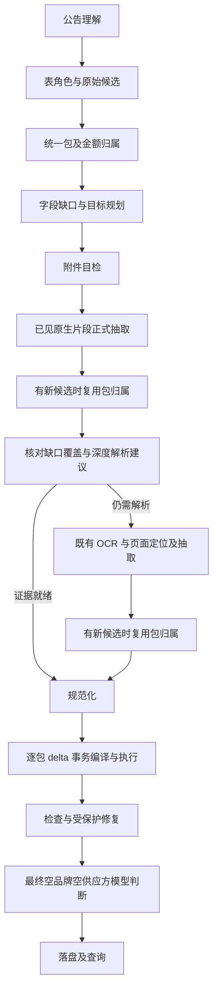

# 主路线实现细则

2026-10-13：官方三表兼容已实施，当前契约v1.3（10-14编号衔接修复）、第8步规范v10，执行协议仍delta-v5。完整逐阶段说明见[官方兼容规范](../doc/官方三表兼容与流程衔接-20261013.md)，上一版见[历史快照](archive/主路线实现细则-20261013前.md)。10-10 集成优化及更早历史性能数字只对应当时版本。旧并发版说明保存在 [历史快照](archive/主路线实现细则-20261010前.md)。本轮按用户要求仅使用固定回答及上轮过程文件，不调用模型、OCR、业务 API。
当前契约见 [主路线契约](../doc/主路线多步Agent设计契约.md)，delta 规范见 [第8步规范](../doc/第8步标的合并规范.md)。

## 一、执行链路

## 二、改动位置与责任

| 模块 | 改动 |
|---|---|
| evidence.py、candidates.py、schemas.py | 稳定原文引用、空名称观测、字段和归属审计 |
| bindings.py、s02_html.py、pipeline.py | 不再调用旧多包表解析器猜行；模型统一复核已有及未分配候选、金额，附件到达后复用 |
| s03_plan.py | 保留原缺口门，给 needs 加目的、目标、状态，未归属观测可请求补证据 |
| parse/peek.py、parse/screen.py、s04_attach.py | 原生片段沿真实坐标传递，用同一个正式抽取器复用；覆盖验证通过才允许跳过深度解析 |
| s07_normalize.py、catalog.py | 缺名等待合并；编码粘名称通过既有目录匹配规范化 |
| merge_protocol.py、s08_merge.py | delta-v5 九原语、逐字段采用/否定/解释、计算依赖、事务保护；空格不贡献采用 |
| receiving.py、llm.py | 候选/金额/缺口关系独立接收与保留，错误项原值及路径审计，修复携带原回答，区分结构、执行约束、业务与实现错误 |
| sub_merge.py | 多 SUB 包内身份与角色判断，来源取名/得分/金额，联合体整体保留；8b 不复活被否定的中标身份 |
| s09_supplier.py | 合并及修复后按最终 COB 引用判断中标人自供，仅 confirm 填值 |
| state.py | 15 个注册阶段，新增 03b 与 05c；08b 仍非阶段 |
| db/load_runs.py | 原表结构不变，审计额外放 announcement.raw_json |
| server/supply.py、scenes.py、app.py、web | 品牌原值展示、03 品牌替代产品供应方、S1 企业角色复用与品牌独立身份、三表 XLSX，详情展示审查/报价/推断来源 |

## 三、并发和回退

原来的逐表、逐文件、逐包并发和按原顺序回填仍在；发号留在父调用，不因完成顺序漂移。
包归属是跨候选屏障，不能把同一则的部分归属先发布；每次输出须覆盖全部输入候选和包金额槽。
原生与深度解析的归属复核复用同一个实现，不再增加三套包归属算法。
附件独立金额也参与归属，observation_bindings 必须完整覆盖它们。未复核/未决不按建议包号供值。金额性质缺省 unknown，预算/限价不能供成交金额；单包 HTML 未知性质也须模型复核。原编号通过共享目录对应到内部引用；唯一单包快捷路径接受已登记原编号，歧义正文金额锚点带独立金额编号与原文送归属模型，不按同号重复填入。页内数字识别与文件名提示适配目录，多包及歧义保持公告范围，普通包回退不因typed兄弟单元失效。供应商缺口关闭逻辑本次明确不调整。
第 8 步逐包模型请求可并发，编译在候选副本上完成，失败不污染输入。
供应方判断每包独立执行，汇总时再追加审计，不通过共享字段列表并发写入。

模型 JSON/引用非法分别按 schema/plan_constraint 带上次回答及错误路径修复一次。字段不可用等 business 不完整重抽，校验器异常 implementation 不重试；有基线回退明确 partial。独立附件输出合法条目跨修复保留，错误项单独审计，不能将这套接收机制用来拼接 delta 事务。
05c 的 outcome 区分未调用、尝试为空、仅金额及形成候选。原生片段与 needs 状态传给页定位，merge evidence 保存已发现片段；不存在强制并页。原生读取器遵循嗅探容器，修复 DOCX 错后缀再次按 .doc 分派的实现矛盾。
公共 projects.json 为公告v2外壳加 packages；09 增加采购单元元信息与 SUB 报价/审查。数据库表保持原结构，raw_json 保存 official_result、project_map、sub_results；详情和导出统一读取。新类型业务键使用类型和原编号，避免同号标段/包混同且不随公告目录构成变化；缺号或同类型重号按公告ID限定身份，旧未知键不回写。不改服务器配置。
原来无模型的合并路径及既有解析预算、闸门配置继续保留；仅本次授权范围的判定已修改。
没有统计新的厂商费用，也没有因为成本添加截断策略。

## 四、提示词

在线使用 announcement/locate-pages/attachment-extract v4、html-tables/html-candidates v5；screen-file/screen-page v3；merge-objects-v6、package-binding-v4、merge-subs-v2、supplier-completion-v1。执行协议仍delta-v5。
历史提示词供对照，新版本隔离录制键。本轮回放直接复用保存的请求与回答验证执行，不伪装为新版模型已经作出相同决定。
所有提示词通过 fields.py 注入字段含义，原文均作为数据。repair-package-v1 只用于基线替换路径，在线成功计划不生成价格 alternatives。抽取提示词明确预算/限价与成交价格、推荐名次与实际中标身份边界。
图像目检也按缺口判断，不把“没有报价表”当成“没有名称或供应关系证据”。

## 五、验证范围

本次使用项目内 pytest 临时目录，避免 Windows 默认临时目录权限问题。
包含：混合单位双求和、子组失效引用、嵌套重复叶子、明确重复观测、缺名补名与预算隔离、排除行不泄漏规格、明确置空、目录拆码、供应方推断引用、同企业双角色和品牌同名身份分离。
原生复用管线测试使用固定模型回答，明确禁止进入 OCR；验证预算仍为观测且 HTML 价格保留。
前端生产构建需允许 esbuild 启动子进程；本轮已完成构建。
真实模型、OCR 服务和 PostgreSQL 环境上的端到端回归需在对应服务启动后运行，不能把固定回答测试当成准确率结果。
回放应使用新版提示词重新录制，旧录制可用于旧行为比较，不能替代新版模型决策验证。
所有未完成验收统一放 [待优化清单](待优化清单.md)。

10-10 历史本地验证为 179 passed；本轮修改前再次确认同样 179 passed。10-12 新增离线回归后为 198 passed。回放脚本 eval/replay_handoff_20261012.py 处理上轮 110 份合并回答，103 份可执行，其余仍被协议/引用/顺序保护拦截；这是执行统计，不能作为准确率或新版模型成功率。
顺义原回答的三条名称及三条缺口关系保留；济宁 B 包首次计划可执行；中卫首次计划拒绝来源总价后可计算 76800，并保留未决数量。计算结果不证明印章干扰区域原文哪格正确。本轮不启动服务、不重跑50例、不改数据库；新版真实抽取及标注验收统一见待优化清单。
